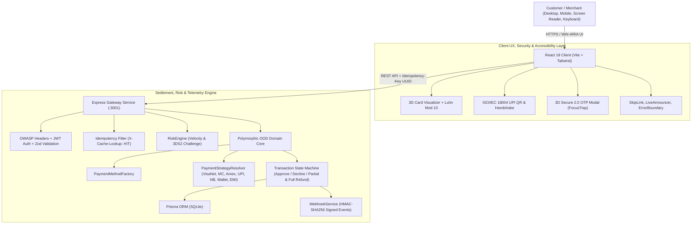

# VisaPay — Enterprise Multi-Rail Payment Gateway & Merchant Console

[](https://www.w3.org/WAI/standards-guidelines/wcag/)
[](https://www.deque.com/axe/)
[](https://www.typescriptlang.org/)
[](https://react.dev/)
[](https://expressjs.com/)
[-2D3748?style=for-the-badge&logo=prisma&logoColor=white)](https://www.prisma.io/)
[](https://www.docker.com/)
[](https://opensource.org/licenses/MIT)

**VisaPay** is a full-stack, accessible digital payment gateway and merchant operations suite built with **React 18**, **TypeScript**, **Express**, **Prisma ORM**, and **WCAG 2.0 Level AA / Section 508** engineering. It models a commercial multi-rail payment processor—supporting **Cards (with 3D Visualizer & 3D Secure 2.0)**, **Camera-Scannable ISO/IEC 18004 UPI QR**, **NetBanking**, **Digital Wallets**, and **EMI Installments**—backed by **Object-Oriented Design (OOD)**, **UUID Idempotency**, **Full & Partial Refunds**, **Hosted Payment Links**, and **HMAC-SHA256 Webhooks**.

---

## Table of Contents
1. [System Architecture](#system-architecture)
2. [Key Features](#key-features)
3. [Software Engineering Principles & Patterns](#software-engineering-principles--patterns)
4. [Accessibility Engineering (WCAG 2.0 AA / Section 508)](#accessibility-engineering-wcag-20-aa--section-508)
5. [Monorepo Project Structure](#monorepo-project-structure)
6. [Quickstart & Local Setup](#quickstart--local-setup)
7. [Sandbox Credentials & Deterministic Test Scenarios](#sandbox-credentials--deterministic-test-scenarios)
8. [Automated Testing & Accessibility Audits](#automated-testing--accessibility-audits)
9. [Docker Deployment](#docker-deployment)
10. [REST API Reference](#rest-api-reference)

---

## System Architecture



---

## Key Features

### Multi-Rail Interactive Checkout (`/checkout` & `/pay/:intentId`)
- **Credit & Debit Cards**: Interactive **3D Physical Card Preview** (live embossing, network themes, smooth 180° flip on CVV focus), Mod 10 Luhn validation, BIN network detection, and vaulted tokenized card quick-pay.
- **3D Secure 2.0 (SCA) Challenge**: Risk-based [RiskEngine](file:///server/src/services/RiskEngine.ts) evaluates transaction value and card triggers (`...3333` or `>= $200 USD`) to present an accessible OTP verification challenge (`123456`) before capture.
- **Real Scannable UPI QR & VPA Verification**: Generates genuine **ISO/IEC 18004** QR matrices (`qrcode`) encoding NPCI-compliant `upi://pay?...` deep links, a 3:00 countdown timer, interactive mobile collect handshake simulation, and live VPA beneficiary lookup (`POST /api/v1/payments/upi/verify`).
- **NetBanking, Digital Wallets & EMI**: Bank clearing selection (`HDFC`, `ICICI`, `SBI`, `AXIS`, `CHASE`, `CITI`), Express Wallets (`Apple Pay`, `Google Pay`, `VisaPay Wallet`), and real-time 3/6/9/12-month EMI installment calculator.
- **Commercial Order Summary**: Split-screen layout with multi-currency FX switcher (`USD`, `INR`, `EUR`, `GBP`), quantity steppers, promo codes (`VISAPAY20`, `DEVFREE`), 4-stage live authorization pipeline overlay, and printable invoices with receipt verification QR codes.

### Merchant Operations Console (`/dashboard`)
- **Overview & Telemetry**: Gross Volume, Net Settled Volume, Refunded Volume, Approval Rate, Average Ticket Size, Recharts revenue trend area chart with **WCAG 1.1.1 Accessible Table View toggle**, and network distribution breakdown.
- **Transaction Audit Drawer & Refunds**: Filterable, searchable, paginated ledger with **CSV Export** and a slide-over audit drawer supporting **Full & Partial Refunds**.
- **Hosted Payment Links**: Create shareable `/pay/:intentId` checkout invoices with custom titles, amounts, and currencies.
- **Developers & Webhooks**: Inspect **HMAC-SHA256** signed webhook deliveries (`X-VisaPay-Signature: t=...,v1=...`), view JSON event envelopes, trigger event replays, and rotate API keys.

---

## Software Engineering Principles & Patterns

- **Object-Oriented Design (OOD) & Encapsulation**: Abstract `PaymentMethod` extended by `CreditCard`, `UpiPayment`, `NetBankingPayment`, `WalletPayment`, and `EmiPayment` using private `#` ECMAScript fields to prevent sensitive PAN/CVV leakage.
- **Factory Pattern (`PaymentMethodFactory`)**: Polymorphically instantiates the appropriate payment domain model from incoming request DTOs.
- **Strategy Pattern (`PaymentStrategyResolver`)**: Routes authorizations across `VisaNetStrategy`, `MastercardStrategy`, `AmexStrategy`, `UpiStrategy`, `NetBankingStrategy`, `WalletStrategy`, and `EmiStrategy` (**Open-Closed Principle**).
- **Finite State Machine (`Transaction`)**: Enforces valid lifecycle transitions (`PENDING -> APPROVED | DECLINED -> PARTIALLY_REFUNDED | REFUNDED`).
- **Idempotency & Fault Tolerance**: UUIDv4 `Idempotency-Key` middleware prevents duplicate charges on retries (`X-Cache-Lookup: HIT`), skipping intermediate `REQUIRES_ACTION` 3DS states.
- **Defense-in-Depth Security**: `bcrypt` password hashing, signed `HS256` JWT sessions, OWASP HTTP security headers (`nosniff`, `X-Frame-Options: DENY`, `HSTS`), Zod runtime validation, and sanitized production error responses.

---

## Accessibility Engineering (WCAG 2.0 AA / Section 508)

| Standard | Implementation | Criterion |
|---|---|---|
| **Keyboard & Focus** | Full tab traversal, visible 3px focus outlines (`outline-offset-2`), and off-screen `SkipLink`. | 2.1.1, 2.4.1, 2.4.7 |
| **Screen Readers & ARIA** | Semantic landmarks, `<fieldset>`/`<legend>`, `aria-describedby` errors, and `LiveAnnouncer` (`aria-live`). | 1.3.1, 4.1.2, 4.1.3 |
| **Modal Focus Traps** | `FocusTrap` locks keyboard focus inside 3DS2, Receipt, and Audit Drawer modals with `Escape` dismissal. | 2.1.2, 2.4.3 |
| **Non-Text Alternatives** | **Accessible Table View** toggle on settlement charts; decorative 3D card marked `aria-hidden="true"`. | 1.1.1 |
| **Contrast & Touch Targets** | High-contrast monochrome mode toggle and `48x48px` minimum button/input touch targets. | 1.4.3, 2.5.5 |

---

## Monorepo Project Structure

```text
visapay-accessible-payment-gateway/
├── packages/shared/           # @visapay/shared — OOD models, Factory/Strategy patterns, Zod schemas, Luhn
├── server/                    # Express API (:3001), Prisma ORM (SQLite), RiskEngine, WebhookService
│   ├── prisma/                # schema.prisma & seed.ts
│   └── src/                   # controllers, middleware, routes, services, verification suites
├── client/                    # React 18 + Vite + Tailwind CSS (:5173 dev / static served in prod)
│   └── src/                   # components (checkout, dashboard, layout, ui), contexts, pages, tests
├── .github/workflows/ci.yml   # GitHub Actions CI pipeline
├── Dockerfile                 # Multi-stage production container
└── docker-compose.yml         # Container orchestration
```

---

## Quickstart & Local Setup

### Prerequisites
- **Node.js** v20+ (tested on Node v24.14.1)
- **npm** v10+

### 1. Clone & Install
```bash
git clone https://github.com/anuragsinghmusics-wq/visapay-accessible-payment-gateway.git
cd visapay-accessible-payment-gateway
npm install
```

### 2. Configure Environment & Database
Create `server/.env` from `.env.example` (never commit `.env` files):
```bash
cp .env.example server/.env
```
Generate Prisma client, push schema, and seed demo data:
```bash
npm run prisma:generate --workspace=server
npx --workspace=server prisma db push
npm run prisma:seed --workspace=server
```

### 3. Build & Run
```bash
# Build all workspaces (shared, client, server)
npm run build

# Start unified production server (serves API + React client on http://localhost:3001)
npm run start --workspace=server

# Or run development servers concurrently (client :5173 + server :3001)
npm run dev
```

---

## Sandbox Credentials & Deterministic Test Scenarios

A collapsible **Sandbox Tools** drawer in the bottom-right corner provides 1-click auto-fill without cluttering the commercial UI.

### Merchant Console Login
- **Email**: `merchant@visapay.demo`
- **Password**: `Password123`

### Test Cards, VPAs & Promo Codes

| Scenario | Input | Expected Outcome |
|---|---|---|
| **Standard Approval** | `4242 4242 4242 4242` | `201 APPROVED` — Instant settlement & signed webhook. |
| **3DS2 OTP Challenge** | `4111 1111 1111 3333` *(or amount >= $200)* | Triggers 3DS2 modal (`OTP: 123456`) → `AUTHENTICATED`. |
| **Insufficient Funds** | `4111 1111 1115 0002` | `402 DECLINED` — VisaNet Code 05. |
| **Fraud Risk Block** | `4111 1111 1113 0004` | `402 DECLINED` — VisaNet Code 59. |
| **UPI Instant Approval** | `alex@visapay` | `201 APPROVED` — Instant settlement on UPI rails. |
| **UPI Collect Decline** | `declined@visapay` | `402 DECLINED` — User rejected collect request (U17). |
| **Promo Discounts** | `VISAPAY20` / `DEVFREE` | Applies 20% off / $10 off in Order Summary. |

---

## Automated Testing & Accessibility Audits

```bash
# Run client unit, checkout, dashboard & Axe-core WCAG 2.0 AA suites (14 tests)
npm run test:client

# Run standalone Axe-core WCAG 2.0 AA + Section 508 audit
npm run test:a11y

# Run backend OOD, auth, multi-rail, 3DS2, refund & webhook integration suites
npm run test:server
```

---

## Docker Deployment

```bash
# Build and start full-stack container on port 3001
JWT_SECRET=your_secure_random_secret docker-compose up --build
```

---

## REST API Reference

- **Auth**: `POST /api/v1/auth/register`, `POST /api/v1/auth/login`, `GET /api/v1/auth/me`
- **Payments**: `POST /api/v1/payments/charge`, `POST /api/v1/payments/tokenize`, `POST /api/v1/payments/upi/verify`, `POST /api/v1/payments/3ds/verify`
- **Ledger & Refunds**: `GET /api/v1/payments/transactions`, `GET /api/v1/payments/transactions/:id`, `POST /api/v1/payments/transactions/:id/refund`
- **Payment Links**: `POST /api/v1/payment-intents`, `GET /api/v1/payment-intents`, `GET /api/v1/payment-intents/:id`
- **Merchant Console**: `GET /api/v1/merchants/dashboard`, `GET /api/v1/merchants/webhooks`, `POST /api/v1/merchants/webhooks/:id/replay`, `POST /api/v1/merchants/api-keys/rotate`

---

## License

MIT License — see [LICENSE](LICENSE) for details.
